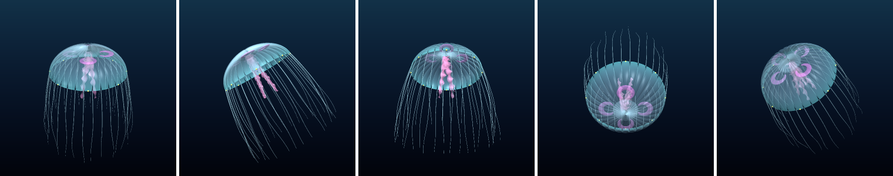

<p align="center"></p>

# GenoCode-cli

`genie` is the command line for [GenoCode](https://github.com/genocode-org/GenoCode), a small
language for creatures you can code, breed and dance. A creature is a `.genie` text file. With
`genie` you can check, format, draw, mutate, breed and morph creatures from a terminal or a
script, with no browser.



<sub>`genie render --views Medusa.genie medusa.png`</sub>

To write and watch creatures in the browser, use the [GenoCode app](https://genocode.piorek.co.za/app/).
New to the language? Start with [Getting started](https://genocode.piorek.co.za/docs/).

## Install

You need [Node.js](https://nodejs.org) 22 or later.

```
npm install -g @genocode/cli
genie --help
```

Any creature in GenoCode's [starter library](https://github.com/genocode-org/GenoCode/tree/main/creatures)
works with the examples below. Download one, such as `Medusa.genie`, and try:

```
genie check Medusa.genie
genie render Medusa.genie medusa.png
```

## Commands

### Look at a creature

- `genie check <files…>`: reports errors and warnings. For a good file it says OK and what the
  file holds: genes, parts and variants.
- `genie genes <file>`: lists the creature's genes, with their ranges and comments.
- `genie variants <file>`: lists the creature's variants and the genes each one sets.
- `genie build [--json] <file>`: builds the creature and reports its shapes. `--json` prints all
  of them.
- `genie jumps <files…>`: finds where colours jump while a creature morphs through its
  variants.

### Draw a creature

`genie render <file> <out.png>` draws a creature as a PNG picture. Options:

- `--size=N`: the picture is N×N pixels (default 512).
- `--time=T`: draw it T seconds into its animation (default 0, the rest pose).
- `--variant=Name`: draw one of its variants.
- `--beat=B` and `--music=bass:0.8,mid_hit:1`: draw it B of the way through a beat (0 to 1) and
  with these music values, to see how it reacts to a song.
- `--view=V`: see it from another side: `front`, `right`, `back`, `left`, `top`, `bottom`,
  `three-quarter`, or `yaw,pitch` in degrees.
- `--views` or `--views=front,top`: draw several views side by side.

A pattern file is drawn as a ball wearing the pattern.

```
genie render --size=1024 Medusa.genie big.png
genie render --variant=LionsMane --time=2 Medusa.genie lionsmane.png
genie render --views=front,top Peacock.genie peacock.png
```

### Make new creatures

- `genie mutate [--strength=S] <file> [out.genie]`: a variation of a creature. About four genes
  move, by up to S of their range (0 to 1, default 0.25).
- `genie breed <a> <b> [out.genie]`: a child of two creatures, with A's code. Genes with the same
  name and kind in both are mixed; the rest keep A's values.
- `genie morph [--at=T] <a> <b> [out.genie]`: the creature T of the way from A to B (0 to 1,
  default 0.5).

These print the new creature, or save it to `out.genie`. `--seed=N` gives the same result every
time, and `--lock=a,b` keeps the named genes as they are. Creatures that say `breed off` can't be
mutated or bred.

```
genie mutate --seed=7 Medusa.genie Medusa2.genie
genie breed Medusa.genie Starfish.genie Child.genie
genie morph --at=0.3 Medusa.genie Starfish.genie Between.genie
```

### Tidy files

`genie format <files…>` prints files in the standard layout. `--write` saves them, and `--check`
only lists the files that aren't formatted, which is handy in CI.

```
genie format --write *.genie
```

### Translate a DancerDNA creature

`genie translate <file.pop> [out.genie]` turns a population file from DancerDNA, the 1999
program GenoCode grew out of, into one GenoCode creature: the first member becomes the creature,
with its genes named, and every other member becomes a `variant`. The result looks the same as
the original. It's a starting point to tidy by hand: anything it couldn't translate, such as
textures, is marked with a `// TODO` comment and listed as it runs. No DancerDNA files are
included here.

### Versions

`genie --version` prints the version of `genie`, of the GenoCode language it understands, and of
the renderer that draws its pictures.

## Development

You need Node.js 22 or later (see `.nvmrc`). The language and the renderer come from npm as
[`@genocode/core`](https://www.npmjs.com/package/@genocode/core) and
[`@genocode/render`](https://www.npmjs.com/package/@genocode/render).

```
npm install
npm run check
```

`npm run check` builds, type-checks, tests and checks formatting, as CI does. After
`npm run build`, run `node packages/cli/dist/main.js <command>`, or run
`npm link -w @genocode/cli` once to get a `genie` command.

To try a change in `@genocode/core` before it's released, build it in a GenoCode checkout and run
`npm link ../GenoCode/packages/core` here.

Contributions follow GenoCode's
[CONTRIBUTING.md](https://github.com/genocode-org/GenoCode/blob/main/CONTRIBUTING.md).

## Releasing

Bump `version` in `packages/cli/package.json`, commit, and push a tag with the same version, such
as `v0.9.5`. The release workflow stages the new version on npm, where it waits for approval.

## License

Released under the [MIT License](LICENSE). See [CREDITS.md](CREDITS.md).
